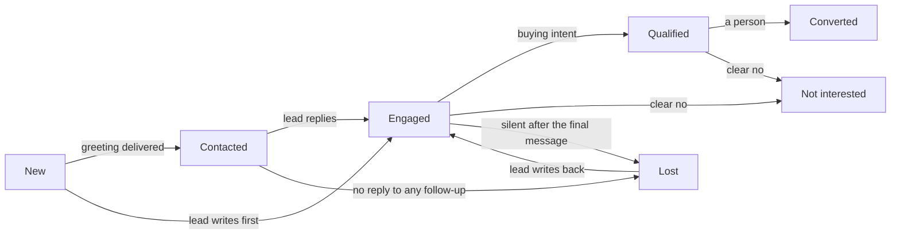

# Lead statuses

Every lead has one status that says where it is in your funnel. Most changes happen on their own as the AI and the follow-ups work. **Converted** is the one status only a person sets.

Engage › **Leads** › click the status badge

## What each status means

| Status | Means | Set when | Set by |
|---|---|---|---|
| **New** | Just captured. Nothing has been sent yet. | A lead is captured. Also when a lead who declined or went silent submits a form again, or a customer enquires about a different product. | System |
| **Contacted** | We reached out. The lead hasn't replied yet. | The greeting is delivered. | System |
| **Engaged** | The lead replied at least once. | The lead's first reply, on any channel. Also when a **Lost** lead writes back. | System |
| **Qualified** | The lead clearly wants to go ahead. | The AI sees buying intent: the lead asks how to buy, pay, order, book or get started, or confirms a demo or visit. Questions about price, features or comparisons alone don't count. | AI |
| **Converted** | The lead became a customer. | Someone marks it. Qualified leads nobody marks are [reminded and escalated](#did-a-qualified-lead-buy). | Agent or admin |
| **Not interested** | The lead clearly said no. | The AI sees an explicit decline (*"not interested"*, *"no thanks"*, *"I bought elsewhere"*). Not for objections (*"too expensive"*) or *"not now"*. Those get a normal reply or a [scheduled follow-up](../nurture-campaigns/follow-ups.md#requested-follow-ups). | AI |
| **Lost** | The lead went silent. | No reply to the greeting and every follow-up, or no reply to the [final message](#before-a-lead-is-marked-lost) after they had replied before. | System |

You can always set any status yourself (see [Changing a status](#changing-a-status)).

## How statuses move

- **Automatic changes only move a lead forward**: New → Contacted → Engaged → Qualified. A lead never goes back to an earlier stage on its own.
- **Converted, Not interested and Lost are outcomes.** The AI and the system never overwrite them, with two exceptions:
    - A **Lost** lead who writes back becomes **Engaged** again.
    - A **new form submission** (re-capture) can start the lead again at **New** (below).
- A **Not interested** lead who writes back keeps that status. The AI still answers them.
- A **Qualified** lead is never marked Lost automatically. A person decides whether they bought.
- **Your changes win.** Automation never undoes a status you set, except by moving the lead forward. It only touches an outcome you set through the two exceptions above.
- Test chats from the campaign wizard never change a status.

## When a lead submits another form

When a lead you already have fills in another form, from any lead source:

| Their status | Same product | Another product |
|---|---|---|
| New, Contacted, Engaged, Qualified | No change | No change. They get the new product's greeting. |
| Not interested, Lost | Back to **New**: a new form is a fresh opt-in | Back to **New** |
| Converted | Stays **Converted**. You and the agent are told an existing customer enquired again. | Back to **New** for the new product. Their earlier conversion still counts for the first product. |

The dashboard's **Leads enquiring about several products** card counts leads who talked to you about two or more products.

## When the AI decides

On every reply, the AI says whether this message shows the lead is **qualified** or **not interested**, with a short reason that appears in the status history. The app then checks the rest of the AI's answer:

- **Buying intent** (*ready to buy*) always means Qualified.
- **"Not interested" is ignored** when the same message shows buying intent, or when the lead asks to be contacted later.
- **Stop if not interested** (per campaign, in [step 2](../nurture-campaigns/ai-and-channels.md#when-a-lead-says-no)):
    - **On** (default): when the lead declines, the AI says a short goodbye, every pending follow-up is cancelled and the conversation closes as *Lead not interested*.
    - **Off**: the lead is still marked Not interested, but the AI makes one gentle attempt to address their reason, and follow-ups already scheduled still go out.
- **"Stop messaging me"** (*"stop"*, *"unsubscribe"*) always stops everything, whatever the setting.

## Before a lead is marked Lost

A lead who replied and then went quiet gets **one final message** before being marked Lost:

1. The conversation goes quiet. After the workspace's [auto-close time](../workspace/workspace-settings.md#conversations) it is kept open instead of closing.
2. After the campaign's **final message** delay (default **48 hours**, set in [step 2](../nurture-campaigns/ai-and-channels.md#final-message-before-marking-a-lead-lost)), the AI writes one short message. It picks up where the conversation left off and says you'll close this out for now.
3. A reply keeps the conversation going. No reply within the campaign's *Close as "No response"* time (default 48 hours) closes it and marks the lead **Lost**.

Final messages go out on **Email, SMS and WhatsApp**. WhatsApp uses the follow-up template. On other channels the lead is marked Lost after the same total wait, without a final message. With the final message turned off (0 hours), the lead is marked Lost once the conversation closes for inactivity. Agents and admins aren't notified about any of this. It's recorded in the lead's status history.

## Changing a status

Click the status badge on the lead's details (from **Leads**, or the lead panel in **Conversations**) and pick the new status.

- **Admins** can change any lead.
- **Agents** can change leads in conversations assigned to them (permission *Change lead status*, which the Agent role has).
- **Converted**, **Not interested** and **Lost** ask for an optional note, e.g. *Paid invoice #1042*.
- Undoing **Converted** (picking another status) means the lead no longer counts as a conversion.

## Status history

The lead's details show every status change, newest first:

- the new and the previous status
- **who** made the change: the AI, the system, or the team member's name
- **why**, e.g. *Greeting delivered*, *Asked for the payment link* or your note
- **when**, and the product and conversation it happened in

The history is permanent. Conversion numbers on the dashboards and the Pipeline page come from it.

## Did a Qualified lead buy?

Only a person knows whether a lead paid, so nobody should forget to mark it:

| When | What happens |
|---|---|
| The lead becomes **Qualified** | The usual high-intent alert. |
| After the **reminder** window (default **24 hours**) | The lead's agent is reminded: *"Did Ravi buy? Mark the lead Converted or Lost."* With no agent on the lead, admins get it. |
| After the **escalation** window (default **72 hours**) | It's reported to admins with the reason. |
| At reminder time, if the agent is **unreachable** | It's reported to admins straight away. Unreachable means offline for more than a day, set to unavailable, or no longer in the workspace. |

Each step happens once per Qualified period. Marking the lead Converted or Lost (or any other status) ends it. Admins set both windows in [Workspace settings → Lead conversion](../workspace/workspace-settings.md#lead-conversion).

## Pipeline page

Engage › **Pipeline**

For admins:

- **Conversion decisions**: Qualified leads past the reminder window, with the agent reminded, and reported to admins.
- **Awaiting a conversion decision**: those leads, oldest first, with **why** nobody has marked them (*"Ravi has been offline since 21 Nov"*, *"No agent assigned"*, *"Ravi hasn't marked it for 4 days"*). Click one to open it and set its status.
- **Qualified and converted** over time, and **Time to convert** (median, capture → Converted).
- **Why leads were lost**: Lost and Not interested leads by reason.
- **Conversions by agent**: leads each person marked Converted, and their leads still waiting.
- **Leads enquiring about several products**, and the **products enquired about together**.

Agents see **Did they buy?**: their own Qualified leads waiting for a decision.

Every Pipeline card can also be added to a dashboard from **Customize → Metrics**.
