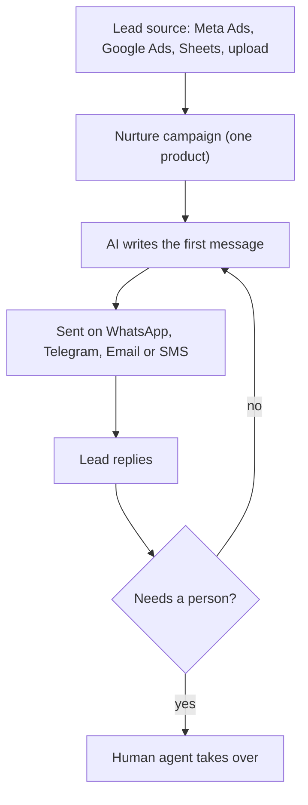

# What is [[ app.name ]]?

[[ app.name ]] is an AI lead follow-up platform. When someone fills in your ad form, the AI messages them within seconds, answers their questions from your own product information, follows up if they go quiet, and hands them to a person on your team when they're ready to buy.

## How it works

1. **A lead arrives.** It comes from a connected [lead source](../setup/lead-sources/index.md) (a Meta or Google Ads lead form, a Google Sheet or an uploaded file), or the lead messages one of your [channels](../setup/channels/index.md) directly.
2. **The AI sends the first message** on the campaign's primary follow-up channel — usually seconds after the form is submitted, at any hour.
3. **The AI holds the conversation.** It answers only from the campaign's [knowledge base](../nurture-campaigns/knowledge-base.md), in the tone you chose.
4. **Follow-ups happen on their own.** If the lead doesn't reply, the AI follows up a few times, outside quiet hours in the lead's own timezone. If the lead says "message me tomorrow", it comes back tomorrow. See [Follow-ups](../nurture-campaigns/follow-ups.md).
5. **A person steps in when it matters.** When the lead asks for a person, gets upset, shows buying intent or the AI isn't sure, the conversation is [handed off](../engage/handoffs.md) to one of your [human agents](../setup/human-agents.md).
6. **You watch it all live** in [Conversations](../engage/conversations.md), [Leads](../engage/leads.md) and the [dashboards](../engage/dashboards.md).

## Key concepts

| Term | What it means |
|---|---|
| **Workspace** | Your team's space. Everything — campaigns, channels, leads, billing — belongs to a workspace. You own one and can be invited to others. |
| **AI model** | The AI provider, model and API key the platform uses to write messages (OpenAI, Google Gemini, Anthropic Claude, OpenRouter and more). You bring your own key. |
| **Channel** | A messaging connection the AI talks through: WhatsApp, Telegram, Email or SMS (Twilio). |
| **Nurture campaign** (or *nurture*) | One product or offer. It holds the knowledge base, tone, channels, follow-up schedule and handoff rules. Create one campaign per product. |
| **Knowledge base** | The facts the AI is allowed to use: product details, pricing, FAQs, policies. The AI never makes things up beyond it. |
| **Lead** | A prospect, captured from a lead source or from an inbound message. |
| **Conversation** | A chat between a lead and the AI (or an agent) on one channel. |
| **Lead source** | An integration that brings leads in: Meta Ads, Google Ads, Google Sheets or a spreadsheet upload. |
| **Human agent** | A workspace member who receives handoffs. Each has a priority, a capacity and an alert channel. |
| **Handoff** | Passing a conversation from the AI to a human agent. Agents can release it back to the AI later. |

More terms in the [Glossary](../help/glossary.md).

## Who does what

[[ app.name ]] has two built-in roles, and you can create [custom roles](../workspace/team-and-roles.md#custom-roles):

- **Admin** (the workspace owner) — full access: billing, AI models, channels, lead sources, campaigns, team and settings.
- **Agent** — handles conversations handed off by the AI. Can view leads, campaigns and dashboards, send messages, take over and release conversations. Can't change configuration.

## What you need before you start

- [ ] An **API key** from an AI provider — see [AI provider API keys](../third-party/ai-provider-keys.md).
- [ ] Access to **at least one messaging platform**: a WhatsApp Business number (Meta), a Telegram bot, an email mailbox with SMTP, or a Twilio account.
- [ ] *(Optional)* A **Facebook Page** with lead ads, or a **Google Ads** account with lead form assets.
- [ ] Your **product information** — pricing, FAQs, policies — to build the knowledge base.

Ready? Follow the [setup checklist](setup-checklist.md).
