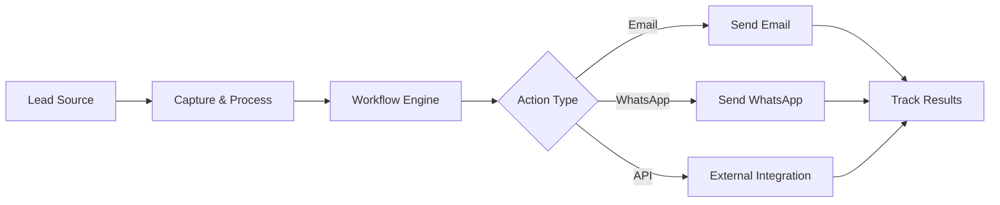

# Introduction to {{ config.extra.company.name }}

## What is {{ config.extra.company.name }}?

{{ config.extra.company.name }} is an intelligent platform designed to streamline your business workflows with AI-powered lead generation, automation, and integrations.

### Core Features

- **Lead Capture** — Automatically capture and organize leads from multiple channels
- **Workflow Automation** — Create sophisticated multi-step workflows
- **Multi-channel Support** — Email, WhatsApp, Telegram, SMS, and more
- **API Integration** — Seamlessly integrate with your existing tools
- **Real-time Analytics** — Track performance with detailed dashboards

## How It Works

## Platform Architecture

### Three Main Components

1. **Capture Layer** — Collects leads from various sources
2. **Processing Layer** — Applies rules, filters, and enrichment
3. **Delivery Layer** — Sends communications via multiple channels

## Who Should Use {{ config.extra.company.name }}?

- 📊 **Marketing Teams** — Automate lead follow-ups
- 🤖 **Sales Operations** — Streamline pipeline management
- 💼 **Business Developers** — Scale outreach efforts
- 🔧 **Technical Teams** — API-first architecture for custom integrations

## What's Next?

Check out the [Getting Started Guide](guides/getting-started.md) to begin your journey with {{ config.extra.company.name }}!

---

**API Base URL:** `{{ config.extra.api.base_url }}`  
**Documentation:** <a href="{{ config.extra.api.docs_url }}">{{ config.extra.api.docs_url }}</a>
