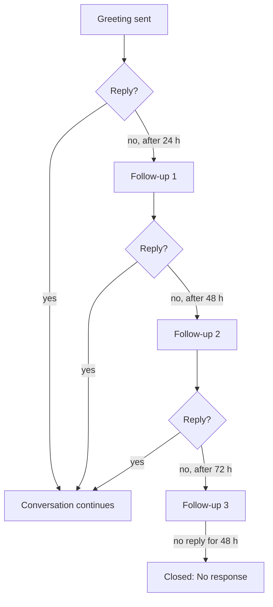

# Follow-ups

[[ app.name ]] follows up with leads in three ways. All of them respect [quiet hours](../workspace/workspace-settings.md#quiet-hours) in the lead's own timezone.

| Type | Triggered by | Set in |
|---|---|---|
| [**First message**](#first-message) | A new lead from a lead source | Campaign's primary follow-up channel |
| [**No-reply follow-ups**](#no-reply-follow-ups) | The lead doesn't reply to the greeting | Campaign wizard, step 2 |
| [**Requested follow-ups**](#requested-follow-ups) | The lead asks to be contacted later | Automatic; default delay in Workspace settings |

## First message

When a lead arrives from Meta Ads, Google Ads, Google Sheets or a spreadsheet, the AI writes a personal first message from the campaign's knowledge base summary and sends it on the **primary follow-up channel** — WhatsApp (using your template), Email or SMS. It normally goes out seconds after the form is submitted, at any hour.

For Sheets and spreadsheet imports you choose **Immediately**, **Later** (a date and time) or **Ignore** during setup.

## No-reply follow-ups

If the lead doesn't reply to the greeting:

- Follow-ups go out on the **same channel** as the greeting, in the same thread for email.
- Email and SMS follow-ups are short and **written by the AI** from the conversation so far. WhatsApp uses your [follow-up template](../setup/channels/message-templates.md#follow-up-template) (or the greeting template, if you chose to reuse it) — with neither, the WhatsApp step is skipped.
- A follow-up due during quiet hours is moved to the end of the quiet window.
- Default timing: **24, 48 and 72 hours** after the greeting (only as many as your [plan](../getting-started/choose-a-plan.md) allows — 2 on Starter), then close **48 hours** after the last one. Change it per campaign in [step 2](ai-and-channels.md#follow-up-automatically-when-a-lead-doesnt-reply).

**The sequence stops when** the lead replies on any channel, taps a button, or opens their [web chat link](../engage/web-chat.md) — or when an agent takes over, the lead's status changes to *Not interested, Converted* or *Lost*, the campaign is paused, or the lead source is disabled. When the sequence ends in silence, the lead is marked **Lost** ([Lead statuses](../engage/lead-statuses.md)).

In **Conversations**, these leads show under the **Awaiting** filter (*Greeting sent, waiting for the lead's first reply*). They don't count as active conversations on dashboards until they reply.

## Final message before Lost

A lead who **replied** and then went quiet gets one last message before being marked **Lost**. By default it goes out 48 hours after the conversation went quiet, on Email, SMS or WhatsApp. If there's no reply, the conversation closes as *No response* after the campaign's close time. Qualified leads are never marked Lost automatically. Set the delay, or turn it off with 0, in [step 2](ai-and-channels.md#final-message-before-marking-a-lead-lost). Details in [Lead statuses](../engage/lead-statuses.md#before-a-lead-is-marked-lost).

## Requested follow-ups

The AI understands requests like *"message me tomorrow morning"* or *"call me next week"*. It schedules the follow-up and comes back on its own at that time, in the lead's local time.

- **"Later" without a time** (*"text me later"*) uses the workspace's **follow-up delay** (default 6 hours), moved out of quiet hours. See [Workspace settings](../workspace/workspace-settings.md#follow-ups).
- **A time the lead chose** is honoured as asked, even inside quiet hours.
- On [web chat](../engage/web-chat.md), the lead can pick how they want to be reached — email, WhatsApp, SMS or back on web chat. If they've left the page, the follow-up goes to the first channel that can reach them.

Scheduled follow-ups show in the conversation (*Follow-up scheduled · Tue, Mar 3 · 9:00 AM*) and in the lead's **Next follow-up** column.

## Quiet hours

By default no automatic follow-ups go out between **9 PM and 8 AM** in each lead's timezone. Greetings to brand-new leads, replies to leads, and call-backs at a time the lead chose are sent as usual. Change it in [Workspace settings](../workspace/workspace-settings.md#quiet-hours).
